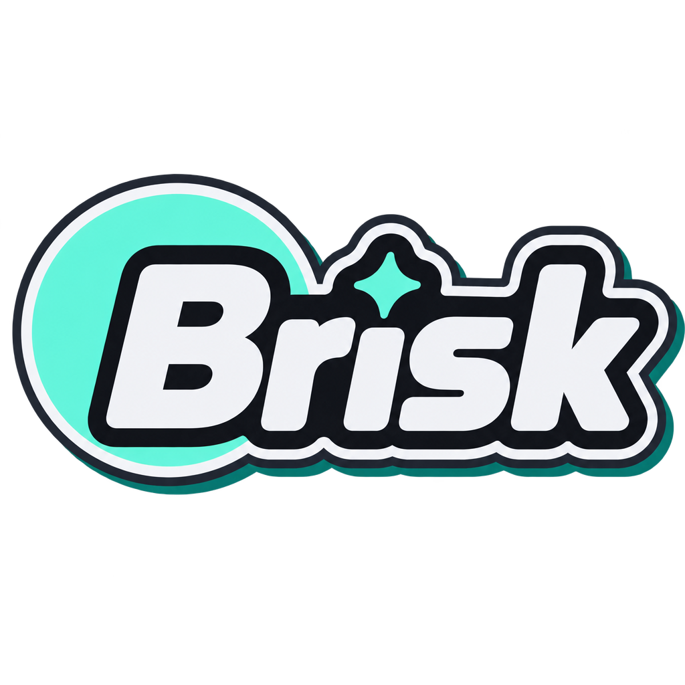

<div align="center">



### Your Sunshine games, in a browser tab. As close to local as physics allows.


</div>

---

Brisk is a web Moonlight client. It plays games from a [Sunshine](https://github.com/LizardByte/Sunshine) host in Chrome over WebTransport and WebCodecs, with a pure-Rust protocol client and bridge behind it.

It exists because the existing web clients felt laggy and clunky. Brisk aims at **low input-to-photon latency**, **steady frame pacing** (a stable frame time beats a low average) and **controller input first**, with rumble coming back. Desktop mouse and keyboard come second.

## What you get

| | |
|---|---|
| **Fast path** | A small Sunshine patch (the "tap") sends encoded frames straight to the bridge, skipping FEC and AES on the host. |
| **Pure Rust** | The protocol client, bridge and host agent are Rust, with no C or C++ in the bridge. `scripts/check-pure-rust.sh` enforces it. |
| **Controller first** | Low-jitter gamepad input with rumble, plus a controller test page and a configurable deadzone. |
| **A real UI** | Library with filters and search, session history, machines, settings, and drag to reorder on Home. |
| **Clips and replay** | Save instant replays and clips, with a configurable replay length. |
| **Honest numbers** | Latency is measured and shown in the UI, and the project measures before it optimises. |
| **Accents** | Mint, indigo, pink, orange, lime or sky. Mint is the default. |

## How it fits together

```
 laptop (Chrome)                                bawn (Sunshine host)
┌──────────────────┐   https, tailnet only    ┌─────────────────────────────┐
│ Brisk web UI     │◄────────────────────────►│ tailscale serve (TLS)       │
│ WebCodecs decode │                          │   ├─ brisk-hostd  (agent)   │
│ WebTransport     │◄════ video/audio/input ══►│   └─ brisk-bridge (QUIC)    │
└──────────────────┘                          │        ▲                    │
                                              │        │ tap (encoded NALs) │
                                              │   Sunshine (patched)        │
                                              └─────────────────────────────┘
```

| Crate | Job |
|---|---|
| `brisk-proto` | Sans-IO protocol: RTSP, RTP, ENet, control messages, audio, pairing. No sockets. Fuzzed. |
| `brisk-client` | Session client and the `brisk-probe` CLI. |
| `brisk-bridge` | Runs beside Sunshine and speaks QUIC and WebTransport to the browser. |
| `brisk-hostd` | Host agent: serves the UI and API, auth, the games library, restarting Sunshine. |

## Run it

The web UI lives in `web/`:

```sh
cd web
npm ci
npm run dev      # dev server on 127.0.0.1
npm run ci       # svelte-check, unit tests, production build
```

The Rust side builds with the pinned toolchain. Use `cargo test` for the tests, or `cargo build --release` for `brisk-hostd`, `brisk-bridge` and `brisk-probe`.

Hosting it for real, with the systemd user service and Tailscale, is in [`docs/hosting-runbook.md`](docs/hosting-runbook.md). The patched Sunshine build is described in [`patches/sunshine/`](patches/sunshine/README.md).

## Read more

- [`docs/design.md`](docs/design.md): goals, non-goals and the architecture decisions
- [`docs/ui-notes.md`](docs/ui-notes.md): the UI, hosting and the full list of checks
- [`docs/hosting-runbook.md`](docs/hosting-runbook.md): standing it up on a host
- [`docs/moonlight-compare.md`](docs/moonlight-compare.md): how it compares with Moonlight
- [`docs/fuzz-inventory.md`](docs/fuzz-inventory.md): what is fuzzed

## Scope

Brisk is a personal project, built around one setup: a Sunshine host, Chrome clients and a Tailscale network. Firefox, Safari, mobile, non-Sunshine hosts and public internet exposure are out of scope for now.

Licensed under the [MIT License](LICENSE).
